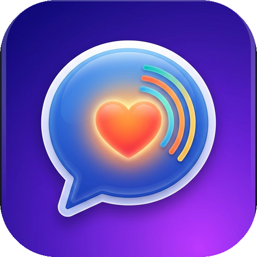

<div align="center">
  
  <h1>Genesis Speech Tab</h1>
  <p><strong>A 100% Free, Clinical-Grade Motor-Planning AAC Speech Tablet App for Non-Verbal Autistic Children</strong></p>
  <p><em>Because no child should lose their voice just because their family cannot afford an expensive device.</em></p>

  <p>
    <a href="https://github.com/Coraje187/Genesis-Speech-Tab-/releases/download/v1.0.0/GenesisSpeechTab.apk">
      
    </a>
    <a href="https://coraje187.github.io/Genesis-Speech-Tab-/">
      
    </a>
  </p>
</div>

---

## 🌟 The Mission

Commercial clinical speech tablets cost between **\$1,000 and \$8,000**, and many subscriptions or proprietary symbol packs lock out families who rely on budget tablets.

**Genesis Speech Tab** brings the clinical gold standards of Augmentative and Alternative Communication (AAC)—fixed motor-planning grids, Fitzgerald Key color coding, visual sentence strips, and real-world autonomy cards—to **any Android tablet, Amazon Fire tablet, iPad, Chromebook, or computer for 100% free**.

---

## ✨ Key Features

### 1. 🧠 Strict Motor Planning + Visual Sentence Strip Bar
* Built on a predictable **5 × 7 coordinate grid** (35 buttons per board) so buttons remain consistent and build unconscious motor memory.
* **Immediate Voice + Visual Sentence Strip**: Every tap speaks the word aloud immediately *and* adds its visual symbol card to the top sentence bar. Tapping **🗣️ Speak** reads the entire sentence smoothly.

### 2. 🍔 Restaurants & Full-Screen "Show What I Want" Order Card
* Dedicated **🍔 Restaurants** board featuring major favorite spots (**McDonald's, Happy Meal, Chick-fil-A, Wendy's, Burger King, Taco Bell, Pizza Hut, Subway, Starbucks, Dunkin', Dairy Queen, IHOP, Panda Express**) alongside popular order items (*Chicken Nuggets, French Fries, Burger, Cheeseburger, Pizza, Taco, Pancakes, Ice Cream, Milkshake, Apple Slices, Chocolate Milk, Juice Box, Ketchup, Sweet & Sour*).
* **🍽️ Show Order Button**: Opens a full-screen, high-contrast visual order card with a **"🔊 Read Order Aloud"** button so children can proudly show restaurant cashiers or servers exactly what they want.

### 3. 📸 Easy Add Word / Photo & Symbol Studio
* Tap **`+ Add Word`** in the top bar (or unlock **`🔓 Edit`** and tap any slot) to customize any board in seconds:
  * **📷 Take Photo / 🖼️ Pick from Gallery**: Snap a photo of your child's actual toy, pet, family member, or favorite snack directly from the tablet camera.
  * **🌐 35,000+ Live ARASAAC Symbol Search**: Search thousands of clinical AAC pictograms online in real time.
  * **🎨 111 Built-In Offline Symbols**: Bundled high-clarity vector symbols ready offline with zero internet required.
  * **💾 Automatic Device Save**: All custom words, photos, and categories persist automatically on the device.

### 4. 🎧 Sensory & Feelings + 1-Tap 🆘 Sensory Overload Card
* Dedicated sensory regulation phrases including *"Dishes Hurt Ears"*, *"Too Loud"*, *"Cover Ears"*, *"Headphones Please"*, *"Bright Lights"*, *"Quiet Space"*, *"Need a Break"*, *"Tight Hug"*, and *"Deep Breaths"*.
* **🆘 Emergency Overload Card**: A 1-tap full-screen medical/sensory alert card explaining that the user is experiencing sensory overload and needs quiet space immediately, with a one-tap loud audio alert.

### 5. 🐾 22 Animals, 🍓 Cartoons, 📚 Learning, 🤟 ASL Signs & ⚡ Slang
* **🐾 Animals**: 22 animals (Dog, Cat, Horse, Cow, Pig, Sheep, Chicken, Duck, Lion, Tiger, Bear, Elephant, Monkey, Giraffe, Zebra, Dinosaur, Bunny, Frog, Fish, Bird, Butterfly, Turtle).
* **🍓 Cartoons**: *Strawberry Shortcake* & friends (*Strawberry Shortcake, Custard the Cat, Pupcake, Berry Bitty City, Orange Blossom, Lemon Meringue, Blueberry Muffin, Raspberry Torte, Sing Song, Watch Episode*).
* **🌎 Multi-Language & Male/Female Voices**: Instant switching between **English (`EN`)**, **Español (`ES`)**, and **Français (`FR`)** with natural **Female (`♀`)** and **Male (`♂`)** voice profiles.

### 6. 🎨 Fitzgerald Key Clinical Color Coding
* **Yellow:** Pronouns & People (`I`, `You`, `Mom`, `Dad`)
* **Green:** Action Verbs (`Want`, `Go`, `Stop`, `Eat`, `Play`)
* **Orange:** Nouns, Places & Foods (`Apple`, `McDonald's`, `Tablet`, `Bathroom`)
* **Blue:** Descriptors, Feelings & Sensory (`More`, `Happy`, `Too Loud`, `Dishes Hurt Ears`)
* **Pink:** Social & Emergency (`Please`, `Thank You`, `Help`, `Overload Card`)
* **Purple:** Peer Slang & Fun (`Bruh`, `Let's Gooo!`, `No Way!`, `Sus`)

---

## 🚀 How to Install & Run

### 📱 Option 1: Direct APK Install (Android & Amazon Fire Tablets)
Download the pre-compiled Android APK directly to your tablet:
👉 **[Download GenesisSpeechTab.apk (Latest Release)](https://github.com/Coraje187/Genesis-Speech-Tab-/releases/download/v1.0.0/GenesisSpeechTab.apk)**

1. Tap the link above on your Android or Fire tablet to download `GenesisSpeechTab.apk`.
2. Open the downloaded file from your tablet's **Notifications** or **Downloads** folder.
3. Tap **Install** (allow installation from your browser if prompted).

### 🌐 Option 2: Run Instantly in Any Web Browser
Open `index.html` directly or run a local web server:
```bash
python3 -m http.server 8090
```
Then visit **`http://localhost:8090`** in Chrome, Edge, or Safari. You can also tap **"Add to Home screen"** on any tablet browser to install it as a full-screen Progressive Web App.

### 🛠️ Option 3: Build from Source with Flutter
```bash
python3 setup_android_build.py
flutter pub get
flutter build apk --release
```

---

## 📜 License & Acknowledgements
* **Software License:** MIT License — 100% Free and Open Source for all families, therapists, and schools.
* **Pictograms & Symbols:** Built-in and online searchable symbols powered by [ARASAAC](https://arasaac.org/) (Creative Commons BY-NC-SA) and custom vector badges.
